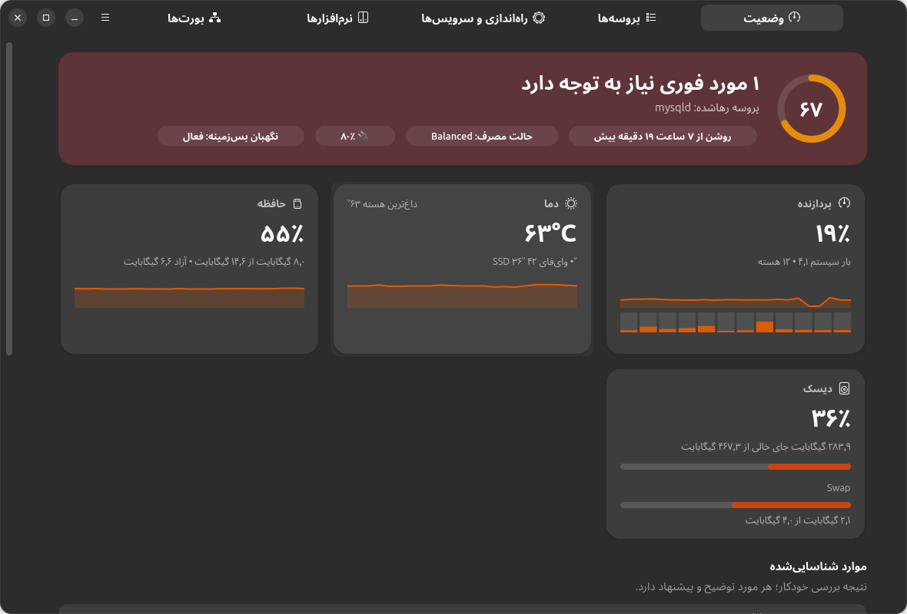
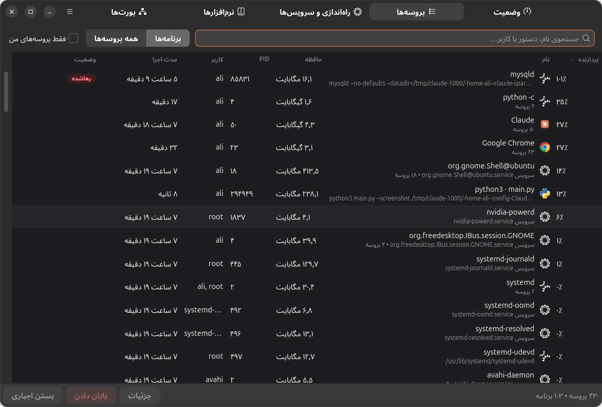
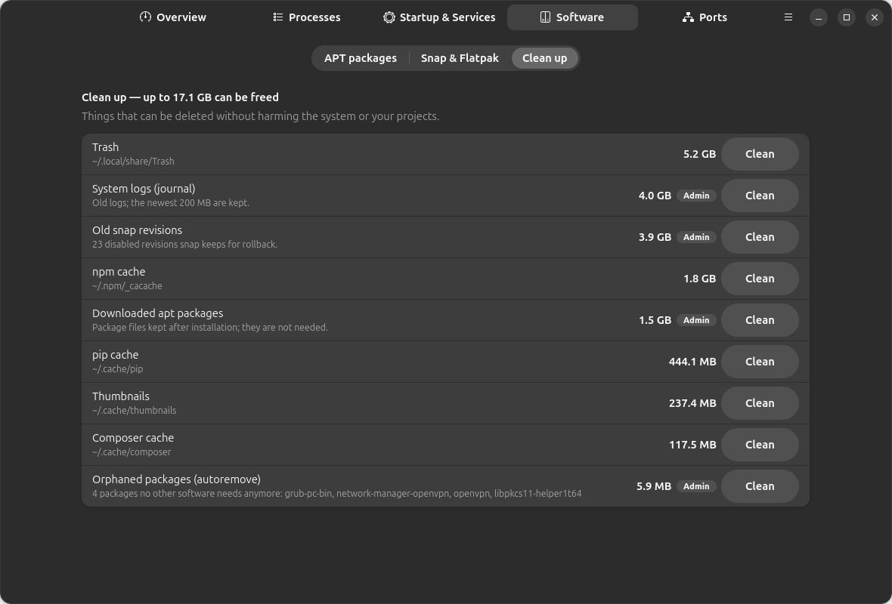

<div align="center" dir="rtl">


# SysWarden

### تسک منیجر و نگهبان سلامت سیستم برای اوبونتو و گنوم (شبیه Task Manager ویندوز)

**بفهم چرا فن لپ‌تاپت همیشه روشن است و با یک کلیک درستش کن.**

[English](README.md) · **فارسی**



</div>

<div dir="rtl">

---

## چرا SysWarden؟

ابزارهای پیش‌فرض لینوکس فقط **عدد** نشان می‌دهند. SysWarden می‌گوید **چه چیزی مشکل دارد، چرا، و چه کار باید کرد**:

> **پروسه رهاشده: mysqld** — پوشه‌ای که با آن اجرا شده دیگر وجود ندارد، پوشه کاری‌اش پاک شده و ۱۱۰ فایل پاک‌شده را باز نگه داشته. برنامه‌ای که اجرایش کرده بود بسته شده و این پروسه رها شده است. ۴ ساعت است اجرا می‌شود و ۹۶٪ از یک هسته پردازنده را مصرف می‌کند.
> 💡 فایل‌هایش پاک شده‌اند، پس بستنش چیزی را خراب نمی‌کند. **[ بستن پروسه ]**

ایده این برنامه دقیقاً از همین اتفاق آمد: یک دیتابیس که یک ابزار توسعه یا ایجنت هوش مصنوعی اجرا کرده بود و هیچ‌وقت بسته نشد، ساعت‌ها یک هسته را ۱۰۰٪ مشغول نگه داشت و فن یک لحظه هم خاموش نشد.

SysWarden هم برای **برنامه‌نویس‌ها** ساخته شده و هم برای **کاربرهای معمولی**، مخصوصاً اگر خودت (یا یک ایجنت) کلی ابزار و پکیج نصب می‌کنی و دیگر نمی‌دانی چه چیزی روی سیستم در حال اجراست.

## امکانات

### 🛡️ تشخیص هوشمند مشکل، با توضیح ساده
- **پروسه‌های رهاشده (یتیم)**: باقی‌مانده‌هایی که والدشان بسته شده و فایل‌هایشان پاک شده (دیتابیس موقت، سرور توسعه، تست)
- **مصرف مداوم پردازنده**: در بازه ۵ تا ۱۰ دقیقه سنجیده می‌شود، نه یک جهش یک‌ثانیه‌ای
- **داغ شدن** پردازنده و SSD، حتی حالت «بیکار ولی داغ»
- **حالت مصرف Performance**: با یک کلیک به Balanced برو و فن آرام‌تر می‌شود
- **کمبود رم و swap**، پروسه‌ای که رم زیادی گرفته
- **سرورهای توسعه‌ای که روشن مانده‌اند** و ساعت‌ها روی یک پورت گوش می‌دهند (node، vite، python، php و…)
- **چند نسخه همزمان از دیتابیس** (MySQL سیستم + XAMPP + داکر)
- **نشت پروسه** و **پروسه زامبی**
- **برنامه‌هایی که بعد از آپدیت ری‌استارت نشده‌اند**، **سرویس‌های خطادار**، **پر شدن دیسک**
- **سرویس‌های توسعه که با روشن شدن سیستم اجرا می‌شوند** (MySQL، PostgreSQL، Docker، Apache، Redis و…)

### 📋 تسک منیجر
- پروسه‌ها **گروه‌بندی‌شده بر اساس برنامه** (مثل ویندوز) یا لیست کامل؛ مرتب‌سازی بر اساس پردازنده، حافظه و مدت اجرا؛ جستجو
- **پایان دادن / بستن اجباری** با محافظ: پروسه‌های حیاتی محیط گرافیکی محافظت می‌شوند، سرویس‌ها به‌درستی از طریق systemd متوقف می‌شوند و برای پروسه‌های root رمز مدیر پرسیده می‌شود
- جزئیات کامل هر پروسه: دستور اجرا، پوشه کاری، زنجیره والدها، سرویس systemd، پورت‌های باز، فایل‌های پاک‌شده

### 🚀 برنامه‌های شروع خودکار و سرویس‌ها
- روشن/خاموش کردن **برنامه‌های اجرای خودکار** (برگشت‌پذیر، بدون دست زدن به `/etc`)
- همه **سرویس‌های سیستم و کاربر** با مصرف رم و یک توضیح کوتاه («چاپگر — اگر پرینتر نداری لازم نیست»)، اجرا/توقف همین الان و فعال/غیرفعال کردن در بوت
- سرویس‌های ضروری علامت خورده‌اند و قفل‌اند تا سیستم خراب نشود

### 📦 نرم‌افزارهایی که نصب کرده‌ای، و اینکه اصلاً استفاده می‌کنی یا نه
- فقط بسته‌هایی که **خودت (یا یک ایجنت)** با APT نصب کرده‌ای، به‌علاوه اسنپ و فلت‌پک
- **زمان نصب**، **دستور دقیق نصب**، حجم و **آخرین زمان استفاده**
- علامت **«احتمالاً بی‌استفاده»** برای چیزهایی که ماه‌ها پیش نصب شده‌اند و هیچ‌وقت اجرا نشده‌اند
- **حذف امن**: اول شبیه‌سازی می‌شود، همه چیزهایی که حذف می‌شوند نشان داده می‌شوند و بسته‌های اصلی سیستم هرگز حذف نمی‌شوند

### 🧹 پاکسازی
سطل زباله، لاگ‌های قدیمی journal، نسخه‌های قدیمی اسنپ، فایل‌های دانلودشده apt، بسته‌های یتیم و کش‌های npm / pip / yarn / pnpm / Composer / Go / Gradle / Playwright؛ هر کدام با حجم و دکمه پاکسازی.

### 🔌 پورت‌های باز
هر پورتی که باز است، برنامه پشتش، اینکه از شبکه قابل دسترسی است یا نه، و دکمه بستن.

### 🔔 کاشی Quick Settings گنوم + اعلان
یک کاشی در منوی Quick Settings (کنار وای‌فای و بلوتوث) که دمای و مصرف پردازنده را زنده نشان می‌دهد، به‌همراه مشکلات پیدا‌شده و پرمصرف‌ترین پروسه‌ها. وقتی مشکل جدی پیش بیاید **اعلانی با دکمه حل سریع** می‌گیری: *بستن پروسه*، *تغییر به Balanced*، *بررسی*، *نادیده بگیر*.

### 🌍 فارسی و انگلیسی
رابط کامل فارسی با چیدمان راست‌به‌چپ و اعداد فارسی. پیش‌فرض انگلیسی است؛ از **منو ← زبان ← فارسی** عوضش کن.

## تصاویر

| پروسه‌ها | پاکسازی |
|---|---|
|  |  |

## نصب

**با یک دستور** (اوبونتو ۲۴.۰۴ یا جدیدتر، محیط گنوم). این را در ترمینال بزن:

</div>

```bash
curl -fsSL https://raw.githubusercontent.com/alimot0077/syswarden/main/install.sh | bash
```

<div dir="rtl">

یا از روی سورس:

</div>

```bash
git clone https://github.com/alimot0077/syswarden.git
cd syswarden
bash install.sh
```

<div dir="rtl">

نصب‌کننده این کارها را انجام می‌دهد:
1. اگر پیش‌نیازی (`python3-gi`، `python3-psutil`، `gir1.2-gtk-4.0`، `gir1.2-adw-1`) نصب نباشد نصبش می‌کند (فقط در این صورت رمز می‌خواهد)
2. SysWarden را **فقط برای کاربر خودت** نصب می‌کند (`~/.local/share/syswarden`)، همراه آیکون در لیست برنامه‌ها و دستور `syswarden`
3. نگهبان سبک پس‌زمینه را فعال می‌کند (`systemd --user`، حدود ۲۰ مگابایت رم)
4. کاشی Quick Settings گنوم را نصب می‌کند. **یک بار از حساب خارج و دوباره وارد شو** تا کاشی ظاهر شود (محدودیت گنوم روی Wayland)

### حذف

</div>

```bash
syswarden-uninstall          # تنظیمات نگه داشته می‌شود
syswarden-uninstall --purge  # تنظیمات هم پاک می‌شود
```

<div dir="rtl">

## حریم خصوصی و امنیت
- SysWarden **هیچ اتصال اینترنتی ندارد**، آماری جمع نمی‌کند و حساب کاربری نمی‌خواهد.
- بدون تأیید تو هیچ چیزی بسته، متوقف یا حذف نمی‌شود. پروسه‌های حیاتی (gnome-shell، systemd، dbus و…) محافظت می‌شوند.

## پیش‌نیازها
- اوبونتو ۲۴.۰۴ LTS یا جدیدتر (یا هر توزیعی با GTK ≥ 4.14، libadwaita ≥ 1.5، PyGObject و psutil)
- گنوم ۴۶ تا ۵۰ برای کاشی Quick Settings (خود برنامه روی هر محیطی کار می‌کند)

## سؤال‌های رایج

**فن لپ‌تاپم همیشه روشن است؛ اول چه چیزی را نگاه کنم؟**
SysWarden را باز کن و بخش **موارد شناسایی‌شده** را ببین. رایج‌ترین دلیل‌ها: یک پروسه رهاشده، یک تب مرورگر، حالت Performance، یا یک سرور توسعه که یادت رفته ببندی.

**حذف نرم‌افزارهای «بی‌استفاده» امن است؟**
«بی‌استفاده» یعنی هیچ‌کدام از برنامه‌های آن بسته در ۹۰ روز اخیر (یا هرگز) اجرا نشده‌اند. پنجره حذف دقیقاً نشان می‌دهد چه چیزی حذف می‌شود؛ قبل از تأیید نگاهش کن.

**با System Monitor خود گنوم چه فرقی دارد؟**
System Monitor فقط عدد نشان می‌دهد. SysWarden مشکل را توضیح می‌دهد، راه‌حل پیشنهاد می‌کند، در پس‌زمینه مراقب است و برنامه‌های شروع خودکار، سرویس‌ها، نرم‌افزارهای بی‌استفاده و پاکسازی را یک‌جا مدیریت می‌کند.

## مشارکت
Issue و Pull Request خوش‌آمد است، مخصوصاً قانون‌های تشخیص جدید، ترجمه و تست روی توزیع‌های دیگر. ترجمه فارسی در [`app/syswarden/locale_fa.py`](app/syswarden/locale_fa.py) است.

## مجوز
[MIT](LICENSE) © ۲۰۲۶ علی مطلقیان

</div>
