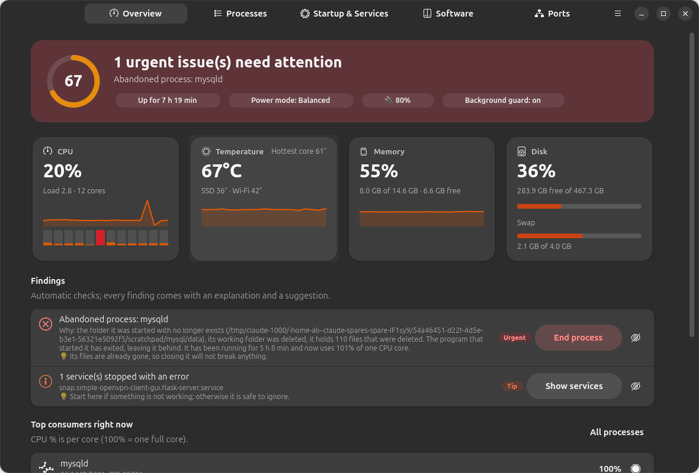
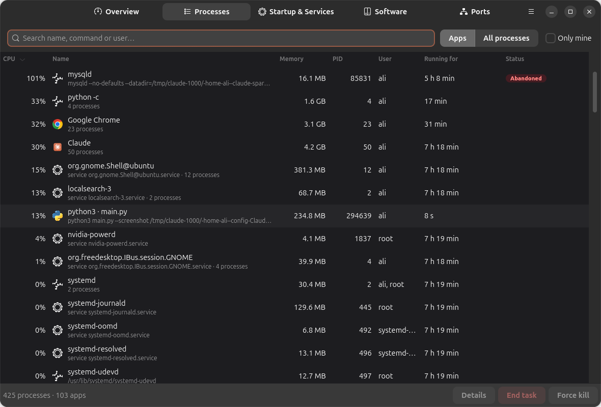
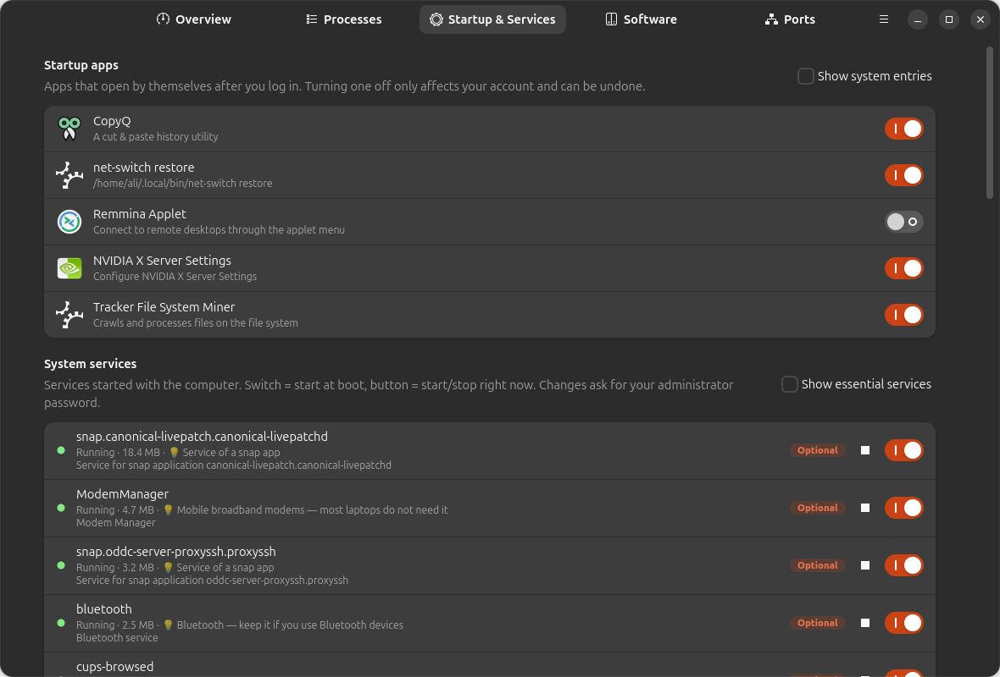
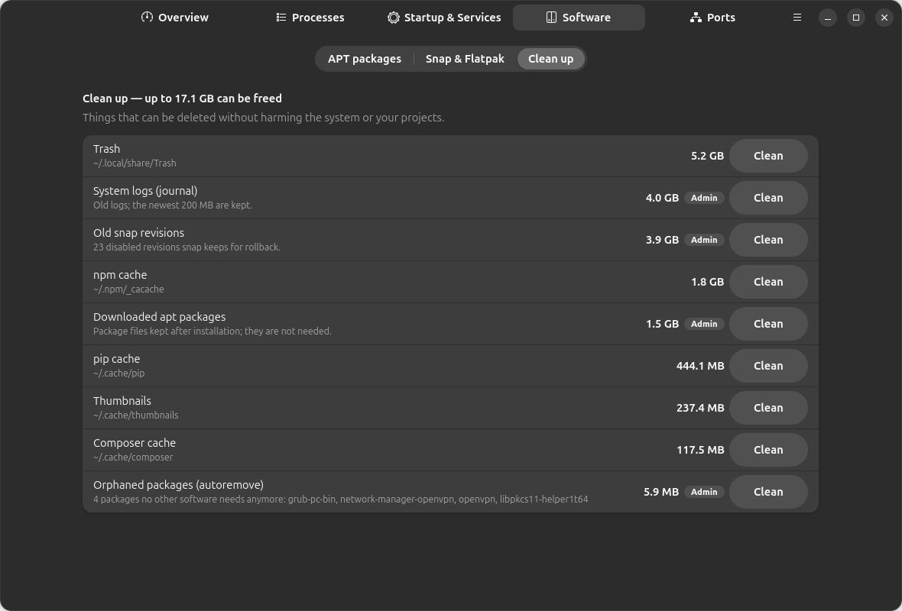
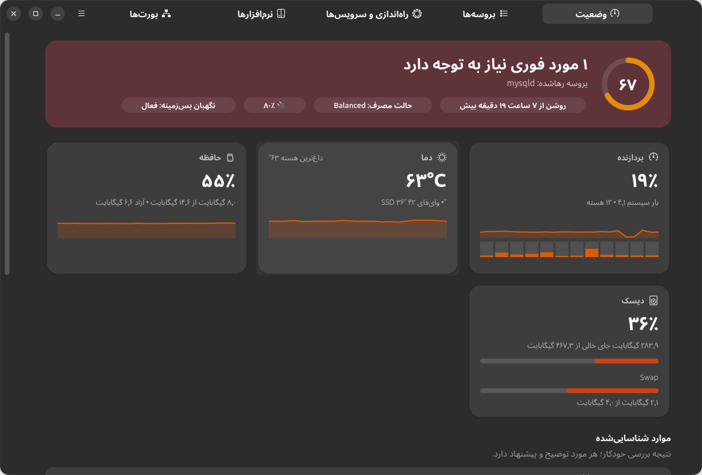

<div align="center">


# SysWarden

### A Windows‑style Task Manager & system health guardian for Ubuntu and GNOME

**Find out why your fan is always on — and fix it in one click.**

[](LICENSE)


**English** · [فارسی](README.fa.md)



</div>

---

## Why SysWarden?

Linux is great until the laptop fan won't stop and you have no idea why. The built‑in tools show you **numbers**. SysWarden tells you **what is wrong, why, and what to do about it**:

> **Abandoned process: mysqld** — the folder it was started with no longer exists, its working folder was deleted, it holds 110 deleted files. The program that started it has exited, leaving it behind. It has been running for 4 h 54 min and uses 96% of one CPU core.
> 💡 Its files are already gone, so closing it will not break anything. **[ End process ]**

That exact case is what inspired it: a database started by a dev tool / AI coding agent that was never stopped and kept one core at 100% for hours.

SysWarden is made for **developers and everyday users** alike, especially if you (or an AI agent) install lots of tools and packages and lose track of what's running.

## Features

### 🛡️ Smart problem detection (with plain‑language explanations)
- **Abandoned / orphaned processes**: leftovers whose parent exited and whose files were deleted (temp databases, dev servers, test runners)
- **Sustained CPU hogs**: measured over 5–10 minutes, not a one‑second spike
- **Overheating**: CPU and NVMe SSD temperature, including "idle but hot" (power mode, dust, airflow)
- **Power mode = Performance**: one click to switch to Balanced for a quieter fan
- **Memory pressure & swapping**, single processes eating too much RAM
- **Leftover dev servers** still listening on a port hours later (node, vite, python, php, ruby, java…)
- **Duplicate database servers** (system MySQL + XAMPP + Docker…)
- **Process leaks** (hundreds of copies of the same process), **zombies**
- **Apps not restarted after an update**, **failed services**, **disk almost full**
- **Development services that start at boot** (MySQL, PostgreSQL, Docker, Apache, Redis, MongoDB…)

### 📋 Task Manager
- Processes **grouped by app** (like Windows), or a flat list. Sort by CPU, memory, age; search by name, command or user
- **End task / Force kill** with safety rails: core session processes are protected, services are stopped properly via systemd (instead of being killed and respawned), root processes ask for your password via polkit
- Details for every process: full command line, working folder, parent chain, systemd unit, listening ports, deleted files

### 🚀 Startup & services
- Turn **startup apps** on/off per user (reversible, never touches `/etc`)
- See every **system and user service** with memory usage and a short explanation ("Printing — not needed if you have no printer"), start/stop now, enable/disable at boot
- Essential services are marked and protected so you can't break your system

### 📦 Software you installed, and whether you ever use it
- Lists only packages **you (or an agent) installed** with APT, not Ubuntu's own, plus Snap and Flatpak apps
- Shows **when** each was installed, the **exact command** used, its size, and **when it was last used** (based on when its programs were last executed)
- Flags **probably unused** software, including things installed months ago and never run
- **Safe removal**: dry‑run first, shows everything that would be removed, refuses to remove core system packages

### 🧹 Cleanup
Trash, old journal logs, old Snap revisions, downloaded APT packages, orphaned packages, and npm / pip / yarn / pnpm / Composer / Go / Gradle / Playwright caches, each with its size and a one‑click clean.

### 🔌 Open ports
Every listening port with the program behind it, whether it's reachable from the network, and a button to stop it.

### 🔔 GNOME Quick Settings tile + notifications
A tile in the Quick Settings menu (next to Wi‑Fi and Bluetooth) shows live CPU and temperature, the current findings and top processes. When something serious happens you get a **notification with a one‑click fix**: *End process*, *Switch to Balanced*, *Open*, *Ignore*.

### 🌍 English & Persian (فارسی)
Full English and Persian UI with proper right‑to‑left layout and Persian digits. Switch any time from **Menu → Language**.

## Screenshots

| Processes (grouped by app) | Startup & services |
|---|---|
|  |  |
| **Cleanup** | **Persian UI (RTL)** |
|  |  |

## Install

**One line** (Ubuntu 24.04 or newer, GNOME):

```bash
curl -fsSL https://raw.githubusercontent.com/alimot0077/syswarden/main/install.sh | bash
```

Or from a clone:

```bash
git clone https://github.com/alimot0077/syswarden.git
cd syswarden
bash install.sh
```

The installer:
1. installs any missing dependencies (`python3-gi`, `python3-psutil`, `gir1.2-gtk-4.0`, `gir1.2-adw-1`), asking for your password only if something is missing
2. installs SysWarden **for your user only** (`~/.local/share/syswarden`), with an app‑grid entry and a `syswarden` command
3. enables the lightweight background watcher (`systemd --user`, about 20 MB RAM, sampling every 5 s)
4. installs the GNOME Quick Settings tile. **Log out and back in once** to see it (a GNOME on Wayland limitation)

### Uninstall

```bash
syswarden-uninstall          # keep settings
syswarden-uninstall --purge  # also remove settings
```

## Usage

| | |
|---|---|
| Open the app | App grid → **SysWarden**, the Quick Settings tile, or `syswarden` |
| Jump to a page | `syswarden --page processes` (`overview`, `processes`, `startup`, `software`, `ports`) |
| Findings in the terminal | `syswarden --check` |
| Change language | Menu (☰) → Language → English / فارسی |
| Restore hidden findings | Menu (☰) → Restore ignored findings |

## How it works

- **App**: Python + GTK 4 + libadwaita, native GNOME look, light/dark theme, adaptive layout
- **Watcher** (`syswarden-watch.service`): samples processes and sensors every 5 s, analyzes every 30 s, writes a small state file to RAM (`$XDG_RUNTIME_DIR`), never to disk. Capped by systemd at 10% CPU and 150 MB RAM; typical use is far below that
- **Tile**: a small GNOME Shell extension that only reads that state file
- **Detection** combines several signals rather than a single threshold: CPU history per process, lifetime CPU average, parent re‑parenting to `systemd --user`, deleted working directories and open files, temp paths on the command line that no longer exist, listening sockets, systemd cgroups (to tell apps from services), and more. Thresholds live at the top of [`rules.py`](app/syswarden/rules.py)

### Privacy
SysWarden makes **no network connections**, has no telemetry, and needs no account. Everything stays on your machine.

### Safety
Nothing is killed, stopped or removed without your confirmation. Core session processes (gnome-shell, systemd, dbus, Xwayland…) are protected. Package removal always runs a dry run first and refuses anything that would remove core system packages.

## Requirements
- Ubuntu 24.04 LTS or newer (or another distribution with GTK ≥ 4.14, libadwaita ≥ 1.5, PyGObject and psutil)
- GNOME Shell 46–50 for the Quick Settings tile (the app itself works on any desktop)

## FAQ

**My fan is always on. What should I check first?**
Open SysWarden and look at **Findings**. The most common causes are an abandoned process, a browser tab, Performance power mode, or a dev server you forgot to stop.

**Is it safe to remove software it marks as unused?**
"Unused" means none of the package's programs were run in the last 90 days (or ever). Libraries and background tools can still be needed; the removal dialog shows exactly what will be removed, so review it first.

**How is this different from GNOME System Monitor?**
System Monitor shows raw numbers. SysWarden explains problems, suggests fixes, watches in the background, and manages startup apps, services, unused software and cleanup in one place.

**Does it work on Fedora / Arch / other desktops?**
The app should work wherever its dependencies exist (the installer's automatic dependency step is for Debian/Ubuntu). The tile requires GNOME 46+. Reports are welcome.

## Contributing
Issues and pull requests are welcome, especially new detection rules, translations, and testing on other distributions.

- Translations live in [`app/syswarden/locale_fa.py`](app/syswarden/locale_fa.py); `python3 tools/check_i18n.py` verifies that every string is translated
- Run from source without installing: `python3 app/main.py`

## License
[MIT](LICENSE) © 2026 Ali Motlaghian

<sub>Keywords: Ubuntu task manager, Linux task manager like Windows, GNOME system monitor alternative, find what is using CPU on Linux, laptop fan always on Linux, kill process GUI, startup applications manager, systemd service manager GUI, remove unused packages Ubuntu, clean Ubuntu disk space, GNOME Quick Settings extension, GTK4 libadwaita app.</sub>
